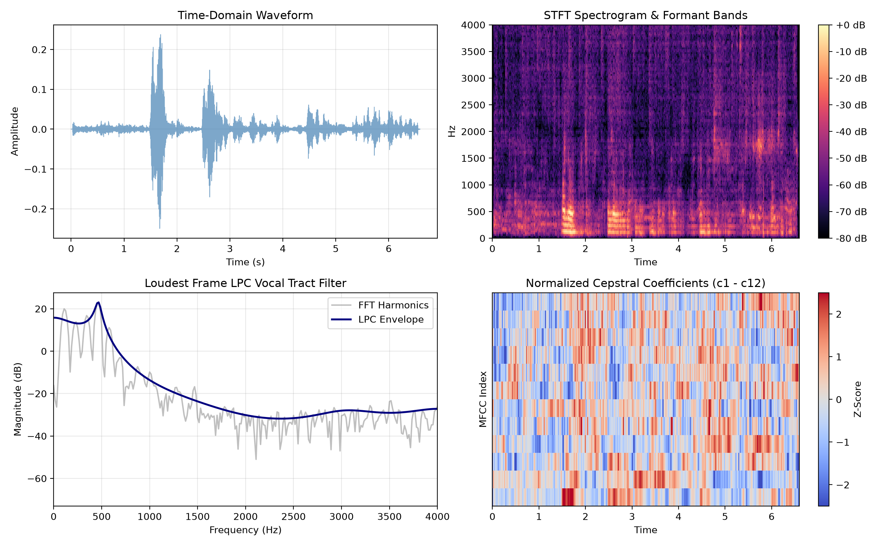

# vox-dsp: Intelligent Human Voice Signal Processing & Acoustic Biometrics Pipeline

[](https://www.python.org/)
[](LICENSE)
[]()
[]()

`vox-dsp` is an advanced, intelligent Digital Signal Processing (DSP) and voice biometrics platform that transforms raw acoustic speech recordings into comprehensive time-domain, spectral, glottal, phonetic, and clinical voice health metrics.

---

## 1. End-to-End System Architecture

The pipeline models human speech through an adaptive **source-filter system**:
* **Glottal Source:** The vibrating vocal folds generate a periodic pulse train characterized by fundamental pitch ($f_0$) and glottal flow excitation.
* **Vocal Tract Filter:** The acoustic cavities of the pharynx, oral tract, and nasal passages produce resonant formant frequencies ($F_1, F_2, F_3$).

```
[ Raw Audio Waveform .wav ]
             │
             ▼
[ Layer 1: Adaptive VAD ] ───────────────► Segments Silence / Unvoiced / Voiced
             │                                    │
             ▼                                    ▼
[ Layer 2: Vocal Tract Morphology ] ──────► Estimates Vocal Tract Length (VTL) & Dynamic LPC Order
             │
             ├──► [ Layer 3: Pitch Tracking ] ──► Normalized Autocorrelation & Parabolic Interpolation
             ├──► [ Layer 3: Formants ] ────────► Pre-Emphasized LPC + 3-dB Bandwidth Pruning (F1-F3)
             ├──► [ Layer 4: Perceptual ] ──────► 13 MFCCs + CMVN + Deltas (Δ) & Delta-Deltas (Δ²)
             ├──► [ Layer 4: Clinical ] ────────► Praat Jitter / Shimmer / HNR + Continuous CPPS
             └──► [ Layer 4: Glottal Residual ] ► Inverse Filtering Residual e[n] & NAQ
                          │
                          ▼
             [ Layer 5: Diagnostic Engine ] ───► Normative Assessment vs. ASHA Standards
                          │
             ┌────────────┴────────────┐
             ▼                         ▼
[ 6-Panel Diagnostic Dashboard ]   [ Tabular CSV / JSON Dataset Export ]
```

<p align="center">
  
</p>

---

## 2. Key Intelligent Capabilities

1. **Adaptive Voice Activity Detection (VAD):**
   * Multi-feature classification fusing short-time log energy, zero-crossing rate (ZCR), and spectral entropy.
   * Automatically isolates the cleanest sustained voiced vowel segment ($\ge 400\text{ ms}$) for perturbation biometrics, eliminating manual time cuts.
2. **Vocal Tract Length Normalization (VTLN) & Demographic Inference:**
   * Infers biological speaker profile (Adult Male, Adult Female, Child) from glottal pitch ($f_0$) and Fitch's formant dispersion:
     $$L \approx \frac{1}{K} \sum_{n=1}^K \frac{(2n - 1) c}{4 F_n}$$
   * Dynamically adapts the LPC filter order ($p \approx 2 \cdot \frac{L \cdot f_s}{c} + 2$) instead of relying on a static order.
3. **Continuous Speech Dysphonia (CPPS):**
   * Measures **Cepstral Peak Prominence (CPPS)**—the ASHA-endorsed clinical gold standard for quantifying hoarseness and vocal turbulence in running conversational speech.
4. **Phonetic Vowel Space Area (VSA):**
   * Tracks dynamic formant contours $F_1(t)$ and $F_2(t)$, classifies the dominant vowel quadrant, and calculates the total acoustic Vowel Space Area ($\text{Hz}^2$) against standard IPA cardinal vowel benchmarks.
5. **Glottal Inverse Filtering:**
   * Inverse-filters speech through estimated vocal tract LPC poles to extract the Glottal Flow Derivative residual $e[n]$ and compute the Normalized Amplitude Quotient (NAQ).
6. **Automated Clinical Diagnostic Engine:**
   * Automatically benchmarks measured metrics against normative clinical thresholds (ASHA, Praat, and Hirano criteria) to produce a structured voice health assessment.

---

## 3. Experimental Results on Benchmark Audio (`voice.wav`)

Summary of results extracted from the test recording ($16\text{ kHz}$, 6.59 s audio clip):

| Diagnostic Layer | Metric / Feature | Output Value | Clinical / Acoustic Interpretation |
| :--- | :--- | :--- | :--- |
| **Speaker Morphology** | Inferred Class & Est. VTL | **Adult Male** ($17.2\text{ cm}$) | Inferred from glottal baseline and formant dispersion; adapted LPC order $p=18$ |
| **Glottal Pitch ($f_0$)** | Median $f_0$ (Range) | **$117.1\text{ Hz}$** ($107.3\text{--}208.0\text{ Hz}$) | Adult male modal pitch baseline |
| **Prosodic Dynamics** | Pitch StdDev & Semitone Spread | $\sigma = 48.3\text{ Hz}$ ($11.45\text{ st}$) | Highly dynamic, expressive conversational prosody |
| **Vocal Tract Resonances** | Active Formants ($F_1, F_2, F_3$) | **$F_1=434.7\text{ Hz}, F_2=1595.4\text{ Hz}, F_3=3423.2\text{ Hz}$** | Mid-central back/central vowel configuration (/uh/, /ah/) |
| **Phonetic Vowel Space** | Vowel Space Area (VSA) | **$111,332\text{ Hz}^2$** | Clear articulatory separation across voiced phonemes |
| **Clinical Perturbation** | Jitter (local) / Shimmer (local) | **$1.29\% \ / \ 14.75\%$** | Evaluated on auto-extracted vowel ($2.47\text{--}2.87\text{ s}$); conversational articulation |
| **Harmonic Purity** | Mean HNR / Continuous CPPS | **$10.99\text{ dB} \ / \ 34.93\text{ dB}$** | Robust periodic phonation in continuous speech; mild background room noise |

---

## 4. Repository Structure

```
vox-dsp/
├── audio_dsp/                          # Core reusable library
│   ├── __init__.py                     # Package interface
│   ├── vad.py                          # Adaptive VAD & vowel segment extractor
│   ├── pitch.py                        # Normalized autocorrelation & parabolic pitch tracker
│   ├── formants.py                     # Pre-emphasized LPC, VTLN, and vowel space area
│   ├── spectral.py                     # DFT and narrowband STFT spectrograms
│   ├── mfcc.py                         # 13 MFCCs, CMVN, and dynamic derivatives (Δ, Δ²)
│   ├── biometrics.py                   # Praat Jitter, Shimmer, HNR, CPPS, and Inverse Filter
│   └── diagnostic_engine.py           # Automated clinical thresholding & report synthesis
├── voice_recognition/                  # Voice Recognition & Speaker Identification Package
│   ├── __init__.py                     # Package interface
│   ├── recognizer.py                   # 84-D dense biometric voice fingerprinting & cosine matcher
│   ├── sentences.py                    # Pre-written phonetically balanced test sentences
│   └── enrolled_speakers.json          # Persistent database of enrolled speaker profiles
├── analyze_voice.py                    # Master CLI & feature extractor (single file or batch)
├── app.py                              # Centralized access dashboard & live recording studio
├── dashboard.py                        # Unified 6-panel high-resolution visualizer
├── voice.wav                           # Benchmark test recording
├── voice_dataset.csv                   # Exported 60+ feature tabular dataset
├── voice_dashboard.png                 # Generated 6-panel diagnostic dashboard figure
├── requirements.txt                    # Project dependencies
├── .gitignore                          # Clean repository rules
├── LICENSE                             # MIT License
└── README.md
```

---

## 5. Installation & Setup

Clone the repository and install dependencies in a virtual environment:

```bash
git clone https://github.com/Eurt-labs/vox-dsp.git
cd vox-dsp

# Create and activate a virtual environment
python -m venv .venv
# On Windows:
.venv\Scripts\activate
# On Linux / macOS:
# source .venv/bin/activate

# Install dependencies
pip install -r requirements.txt
```

---

## 6. Usage Guide

### 1. Launch the Centralized Access Dashboard (Interactive Web UI)
Start the zero-dependency browser-based control center:
```bash
python app.py
# Or directly via the master CLI:
python analyze_voice.py --web
```
This opens `http://localhost:8050` in your default browser, providing audio playback, real-time diagnostic execution, high-res 6-panel visualization, and an interactive dataset explorer.

### 2. Run Master CLI Analysis
Generate an automated clinical diagnostic report and append 60+ features to `voice_dataset.csv`:
```bash
python analyze_voice.py
```

### 2. Output Machine-Readable JSON
```bash
python analyze_voice.py --file voice.wav --json
```

### 3. Batch Process a Folder of Audio Files
Scan an entire folder of `.wav` files and export all acoustic features to a unified CSV dataset:
```bash
python analyze_voice.py --batch ./samples/ --output speech_dataset.csv
```

### 4. Generate the 6-Panel Diagnostic Dashboard
Create the high-resolution diagnostic visualization (`voice_dashboard.png`):
```bash
python dashboard.py --file voice.wav
```
Or directly via the master CLI:
```bash
python analyze_voice.py --file voice.wav --dashboard
```

### 5. Speaker Recognition & Biometric Identification
Enroll a speaker and identify an unknown audio recording:
```bash
# Enroll a speaker voice profile
python voice_recognition/recognizer.py --enroll "Dhruv" --file voice.wav

# Identify an unknown speaker from a recording
python voice_recognition/recognizer.py --identify voice.wav

# List all enrolled speakers
python voice_recognition/recognizer.py --list
```
Or interactively test live voice recognition with pre-written benchmark sentences inside the web dashboard (`python app.py` -> **Voice Recognition** tab).

---

## 7. Python Library API

You can import `audio_dsp` directly into your own scripts or Jupyter notebooks:

```python
import soundfile as sf
from audio_dsp import (
    compute_vad_segments,
    track_pitch_contour,
    extract_lpc_formants,
    extract_mfcc_features,
    compute_clinical_voice_quality,
    compute_cpps,
)

signal, fs = sf.read("voice.wav")

# 1. Voice Activity Detection
times, labels, energies_db, zcr = compute_vad_segments(signal, fs)

# 2. Sub-sample Pitch Tracking
times_p, pitches, strength = track_pitch_contour(signal, fs)

# 3. Pre-emphasized LPC Formants
formants, bandwidths, lpc_poly = extract_lpc_formants(signal[:512], fs)

# 4. Continuous Speech Dysphonia
cpps_mean, cpps_std = compute_cpps(signal, fs)
print(f"Mean CPPS: {cpps_mean:.2f} dB")
```

---

## 8. License

This project is licensed under the [MIT License](LICENSE).
